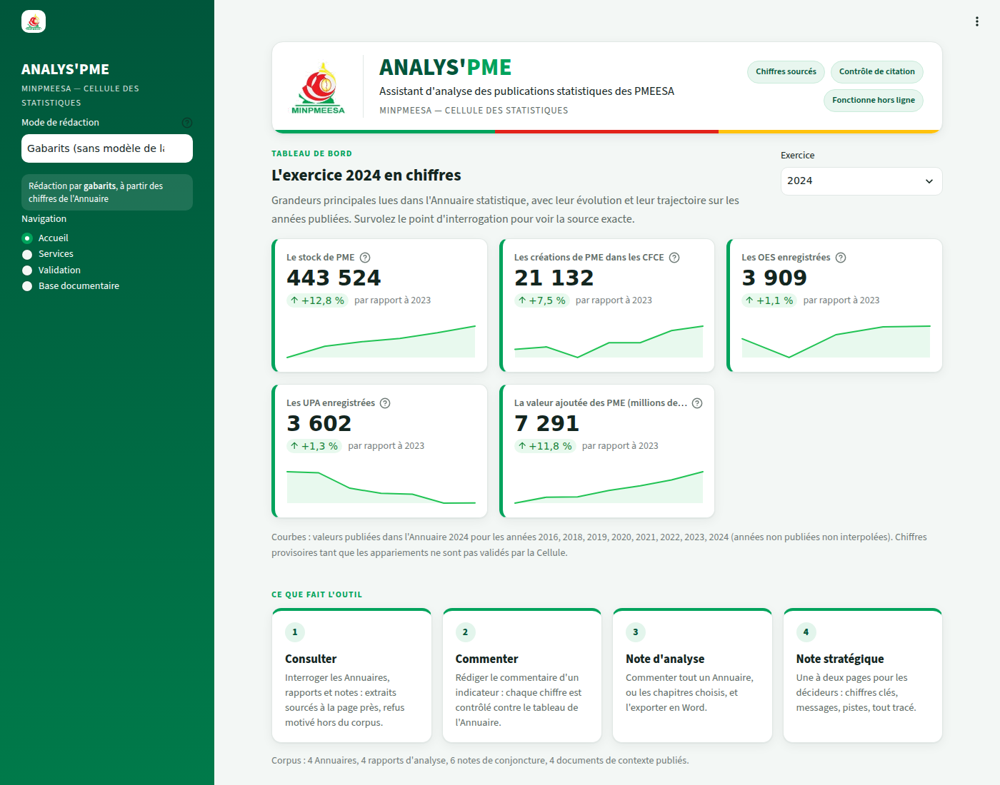
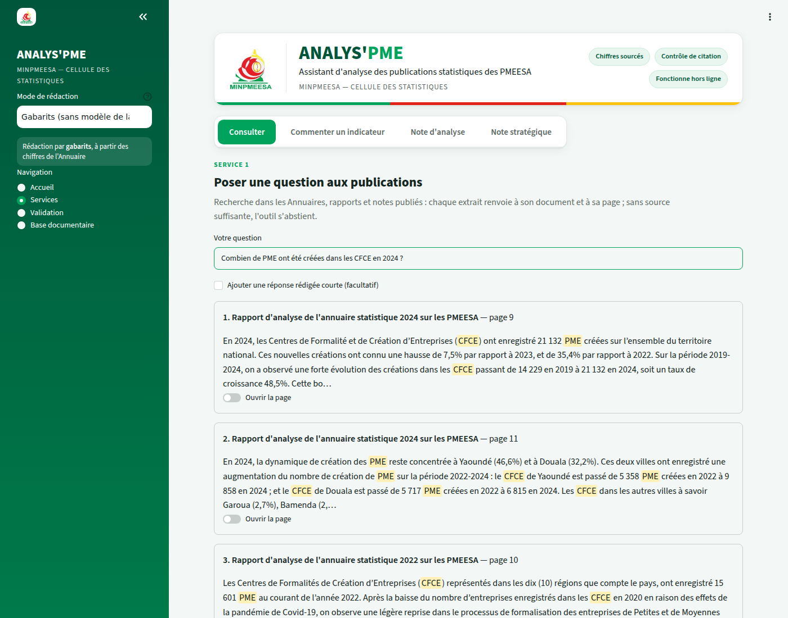
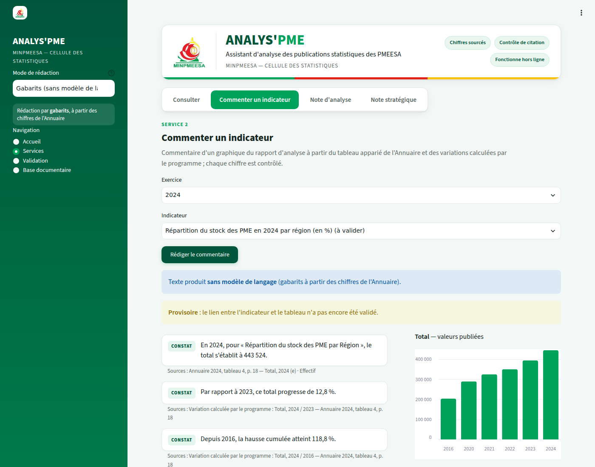
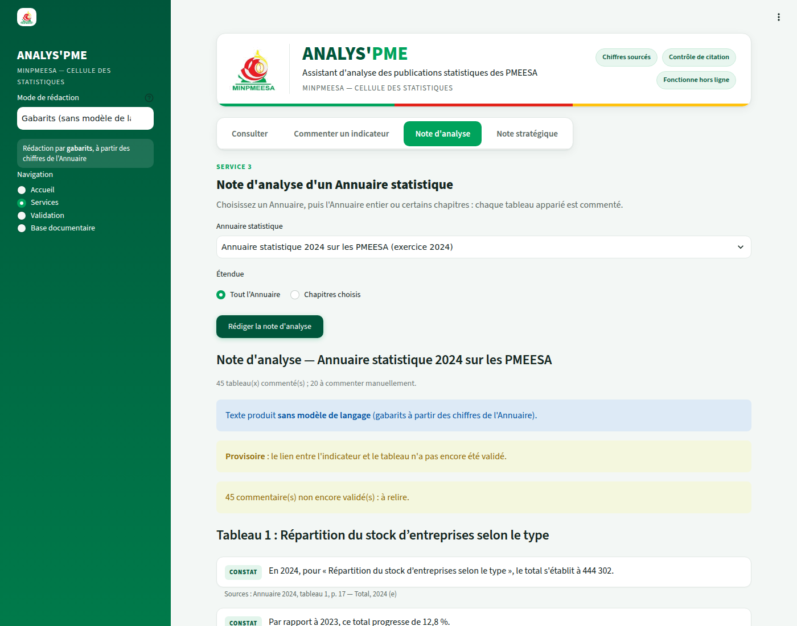
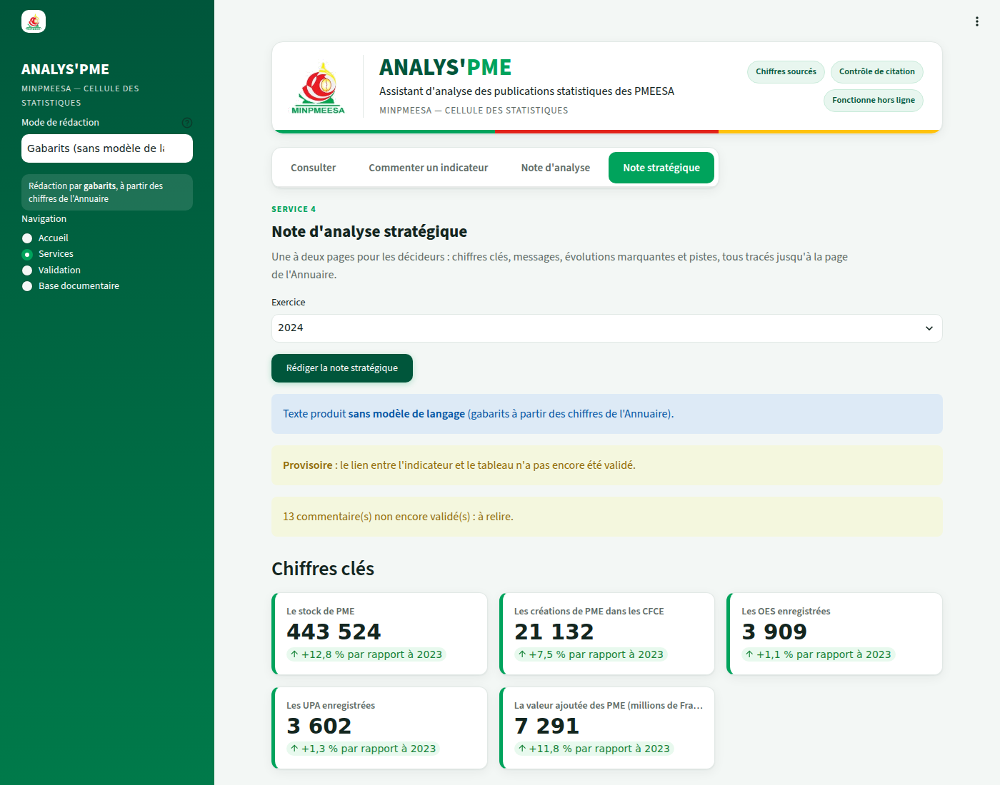
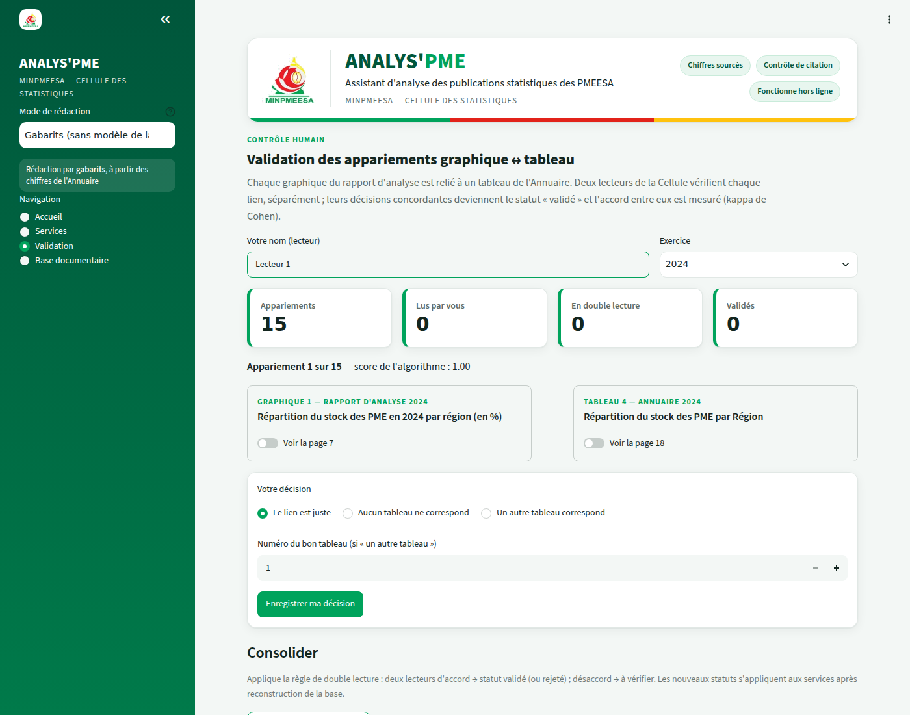

# Guide de l'utilisateur

Lancer l'outil : double-clic sur `demarrer.bat`. La barre de gauche contient :
- **Mode de rédaction** : « Gabarits » (instantané, par défaut si Ollama n'est pas lancé) ou « Modèle de langage
  local » (mieux rédigé, plus lent, toujours contrôlé). L'état réel est affiché juste en dessous ;
- **Navigation** : Accueil, Services, Validation, Base documentaire.

## Accueil

Les chiffres clés de l'exercice choisi (stock de PME, créations, valeur ajoutée, OES, UPA), avec leur évolution et
une petite courbe des années publiées dans l'Annuaire. Le point d'interrogation indique la source exacte
(Annuaire, tableau, page).

Trois messages peuvent accompagner les textes :
- **Sans modèle de langage** : le texte vient de gabarits appliqués aux chiffres de l'Annuaire ;
- **Provisoire** : le lien entre l'indicateur et le tableau n'est pas encore validé ;
- **Non validé** : le commentaire n'a pas encore été relu et validé par la Cellule.

## 1. Consulter

1. Tapez une question en français, puis Entrée.
2. Les 5 passages les plus utiles s'affichent, avec le titre du document, la page et un extrait.
3. « Ouvrir la page » affiche la page du PDF d'origine.
4. Les mots de la question sont surlignés dans les extraits.
5. Si rien de solide n'est trouvé : « Aucune source suffisante trouvée dans les publications », avec des
   **formulations proposées** tirées des intitulés de l'Annuaire (cliquer pour relancer).
   Les documents à usage interne ne sont jamais montrés.

## 2. Commenter un indicateur

1. Choisissez l'exercice et l'indicateur, puis « Rédiger le commentaire ».
2. Chaque phrase est étiquetée CONSTAT ou PERSPECTIVE et suivie de ses **sources** (« Annuaire 2024, tableau 4,
   p. 18 — ligne, colonne » ; ou « Variation calculée par le programme »). À droite, le graphique des valeurs
   publiées de l'indicateur.
3. « Valeurs écartées » liste les chiffres retirés, parce qu'ils ne figuraient pas dans les sources.
4. Sans source suffisante : « sources insuffisantes, à commenter manuellement ».
5. Relisez, puis **« Valider ce commentaire »** : seuls les commentaires validés sont repris dans les notes.
6. « Exporter en Word ».

## 3. Note d'analyse

1. Choisissez l'Annuaire statistique (par exemple « Annuaire statistique 2024 »), puis l'étendue : l'Annuaire entier, ou seulement certains de ses chapitres ; cliquez sur « Rédiger la note d'analyse ».
2. **Présentation « Rapport rédigé »** (par défaut) : introduction, principaux enseignements, puis les chapitres
   et sections de l'Annuaire en titres et sous-titres ; chaque tableau fait l'objet d'un paragraphe rédigé suivi
   de sa source (Annuaire, tableau, page). Un total déjà présenté dans la section n'est pas répété (renvoi au
   tableau). La mise en forme n'ajoute ni ne modifie aucun chiffre.
3. **Présentation « Vérification »** : les mêmes énoncés, un par un, avec la source de chaque valeur.
4. Annexes : tableaux à commenter par la Cellule ; contrôle de cohérence de l'Annuaire (même total, valeurs de
   l'exercice précédent différentes selon le tableau).
5. « Exporter en Word » : même structure (titres de niveaux 1 à 3, paragraphes justifiés, sources en note).

## 4. Note stratégique

1. Choisissez l'exercice, puis « Rédiger la note stratégique ».
2. Rubriques : Messages clés (3), Évolutions marquantes, Points d'attention, Pistes pour la décision, Sources.
3. Chaque évolution est qualifiée : tendance sur trois exercices, ou variation ponctuelle. Un objectif de
   politique publique n'est cité que s'il figure dans une publication, avec la page.
4. « Traçabilité » montre la chaîne énoncé → commentaire → valeur → tableau → page.
5. « Exporter en Word ».

## Validation des appariements

1. Saisissez votre nom, choisissez l'exercice.
2. Pour chaque lien graphique ↔ tableau proposé : lisez les deux intitulés (et, si besoin, les pages), puis
   « Le lien est juste », « Aucun tableau ne correspond » ou « Un autre tableau correspond » (avec son numéro).
3. Un **second lecteur** fait de même, sous son propre nom, sans voir les décisions du premier.
4. « Consolider la double lecture » : deux décisions concordantes → validé (ou rejeté) ; désaccord → à vérifier.
   Le kappa de Cohen est enregistré dans `data/pairing/accord_AAAA.json`.
5. Reconstruire la base (page Base documentaire) pour que les services utilisent les nouveaux statuts.

## Base documentaire

La base est locale : `data/base/minpmeesa.sqlite` (documents, passages, valeurs, variations, appariements,
journal) et `data/base/dense.faiss` (index vectoriel des passages).

1. **Ajouter un PDF** : titre, type, exercice, trimestre, statut. Case « Intégrer tout de suite dans la base »
   cochée (par défaut) : le PDF est copié dans le corpus, inscrit au registre, puis la base SQLite + FAISS est
   reconstruite ; il est aussitôt interrogeable. Case décochée : il est seulement inscrit, et sera intégré au
   prochain clic sur « Reconstruire la base ».
2. **Explorer la base** : compteurs (documents, passages, vecteurs FAISS, valeurs, variations, appariements) et
   onglets Documents, Passages (filtre par document, recherche de mots), Valeurs (par document et tableau),
   Variations (par indicateur), Appariements, Journal des productions.
3. Hors de l'interface, le fichier `minpmeesa.sqlite` s'ouvre avec DB Browser for SQLite (lecture seule
   conseillée).
